# Detailed results

Full results of the project summarised in the [README](../README.md): every figure, the result tables, the formal tests, the CESM2 SMYLE comparison, open questions and limitations. Methods: [methods.md](methods.md) · data: [data.md](data.md) · reproducibility: [reproducibility.md](reproducibility.md).

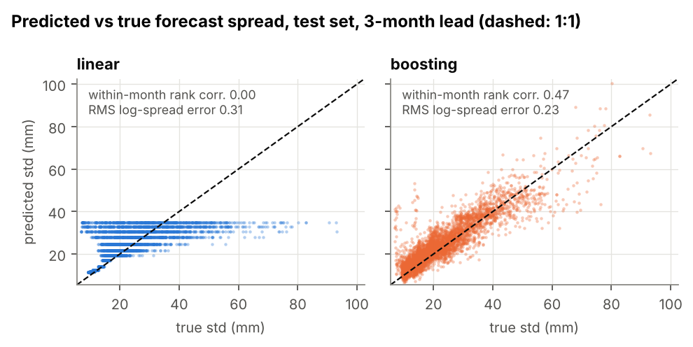

## Questions

| | Question | How it is measured |
|---|---|---|
| Q1 | Does the predicted spread follow the true spread across states and leads? | rank correlation and RMS log error against the true σ |
| Q2 | Are the most-confident forecasts the truly most-predictable ones? | overlap of confident sets; discard plots |
| Q3 | Does attribution of the predicted spread point to the true sources of predictability? | permutation importance compared with the exact attribution of the true σ |
| Q4 | Does the reported confidence stay reliable when the system changes after training? | spread–error ratio and interval coverage under three imposed changes; Part B: model → observations |
| Q5 | How many years of training data are needed before spread estimates are useful? | Q1/Q2 metrics for 70–1000 years of training data |

## The testbed (Part A)

Three coupled components, all monthly (full equations and parameters: [`methods.md`](methods.md)):

1. **ENSO-like recharge oscillator** (after Jin, 1997; Burgers et al., 2005), with seasonal damping and **state-dependent noise**.
2. **Regional precipitation**, linked to ENSO in November–March only. Its noise is skewed (Gamma) and, in the cool season, grows with the ENSO state.
3. **Land storage**: a linear reservoir with six-month memory. The forecast target is storage 1, 3 or 6 months ahead.

The forecast models observe the full state (ENSO index, thermocline, storage, calendar month) and two irrelevant "distractor" series. The true forecast distribution for any test state is therefore obtained by running 1000 stochastic continuations from it. This makes some exact statements possible. For example, the true spread does not depend on current storage (storage shifts only the mean) or on the distractors. Real-world attribution studies have no such reference.

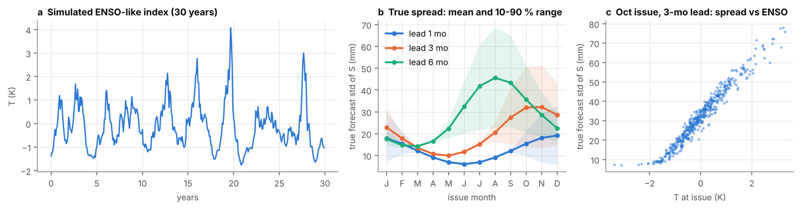
*(a) The ENSO-like index of the toy system. (b) True forecast spread of the storage anomaly by issue month and lead (line: mean; band: 10–90 % range across states). (c) For forecasts issued at the end of October, the true spread grows with the ENSO state: a built-in window of opportunity during La Niña.*

## Part A results

Test set: 500 independent simulated years. Training: 1000 years. Lead: 3 months. Brackets are 95 % block-bootstrap intervals. All six models were run on CPU in 13 minutes ([`reproducibility.md`](reproducibility.md)).

| Model | CRPSS vs climatology | Excess CRPS over truth (mm) | Spread rank corr. within month | Confident-set overlap (chance 0.20) | RMS log spread error | Mean error vs true mean (σ units) | PIT D | 90 % coverage |
|---|---|---|---|---|---|---|---|---|
| climatology | 0 | 14.70 [12.95, 16.46] | 0.00 | 0.20 | 0.91 | 2.19 | 0.007 | 0.877 |
| linear, seasonal σ | 0.542 [0.512, 0.569] | 0.77 [0.64, 0.92] | 0.00 | 0.20 | 0.31 | 0.29 | 0.021 | 0.914 |
| gradient boosting, two-stage | 0.534 [0.507, 0.560] | 0.96 [0.71, 1.25] | 0.47 | 0.50 | 0.23 | 0.45 | 0.021 | 0.918 |
| NN, Gaussian | 0.558 [0.529, 0.585] | 0.37 [0.25, 0.50] | 0.53 | 0.56 | 0.11 | 0.28 | 0.020 | 0.899 |
| NN, SHASH | 0.559 [0.529, 0.585] | 0.34 [0.21, 0.48] | 0.55 | 0.59 | 0.12 | 0.28 | 0.011 | 0.897 |
| deep ensemble (5 × Gaussian NN) | 0.558 [0.529, 0.585] | 0.36 [0.24, 0.48] | 0.56 | 0.58 | 0.11 | 0.28 | 0.022 | 0.915 |
| truth (ideal forecast) | 0.572 [0.541, 0.600] | 0 | 1 | 1 | 0 | 0 | 0.005 | 0.902 |

All leads: [`results/tables/part_a_metrics.md`](../results/tables/part_a_metrics.md).

**Q1. The networks recovered the true spread best.**
- Their spread error (RMS log 0.11–0.12) was half that of gradient boosting (0.23) and about a third of the linear model's (0.31).
- Their gap to the ideal forecast's CRPS (0.34–0.37 mm) was half that of the linear model (0.77 mm). Paired Diebold–Mariano tests confirm that every network had lower CRPS than the linear model at the 1- and 3-month leads (Holm-adjusted p < 10⁻⁶ in all six tests).
- The testbed is needed to see this: the CRPSS intervals of the five trained models overlap, and only the comparison with the truth reveals the large differences in spread ([fig. 4](../results/figures/fig4_metrics_by_lead.png)).


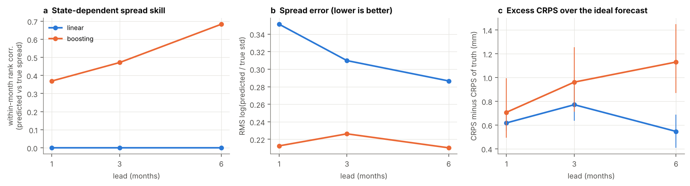

**Q2. Their most-confident forecasts are close to the truly predictable ones.**

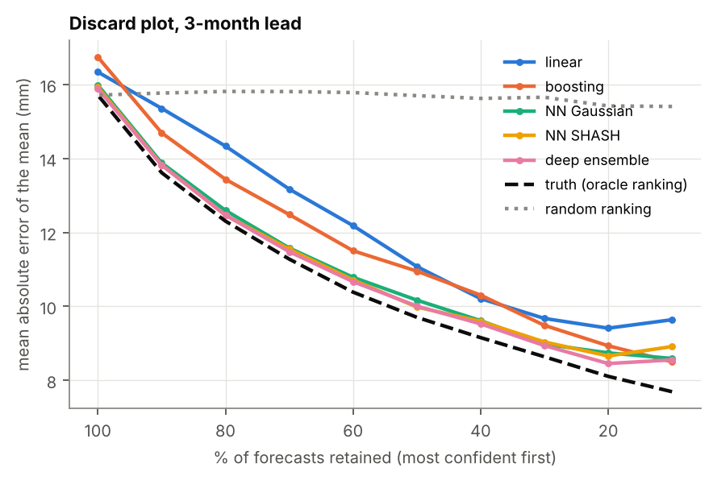
- Keeping only the most-confident forecasts lowers the error of the networks almost as much as keeping the truly most predictable cases (black dashed line), down to about 30 % retained.
- The networks placed 56–59 % of the truly most predictable 20 % of cases in their own most-confident 20 % (chance 20 %, gradient boosting 50 %).

**The shape of the distribution matters.**

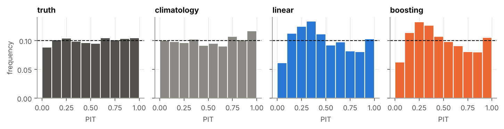
- The precipitation noise is skewed. Models that assume a symmetric (Gaussian) distribution show the same lopsided PIT histogram (deviation ≈ 0.021).
- The SHASH network, which can represent skewness, has the flattest histogram (0.011), closest to the truth (0.005).

**Q3. Attribution of the spread found the true main drivers.** ([fig. 5](../results/figures/fig5_spread_attribution.png))

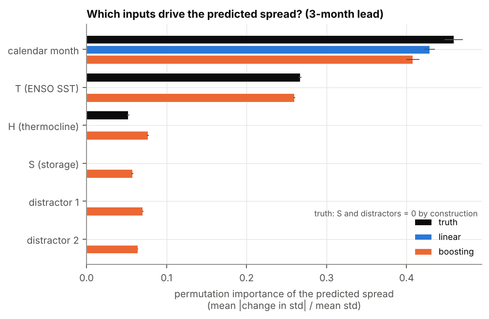
- Calendar month and the ENSO index were attributed at close to their exact true importance by every non-linear model: month 0.41–0.43 vs 0.46; ENSO 0.26–0.28 vs 0.27.

**Q4. The testbed measures how confidence degrades when the system changes.** ([fig. 6](../results/figures/fig6_distribution_shift.png))

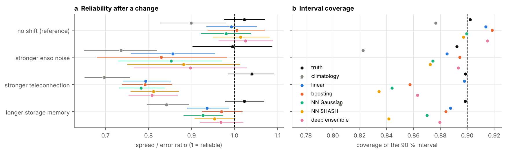
- Before any change, every model was reliable (spread/error ratio ≈ 1, 90 % coverage ≈ 0.90).
- After a 50 % stronger teleconnection, all trained models became overconfident (ratio 0.78–0.81 against 1.04 for the truth). That is a measurable, testable failure mode real-data evaluations cannot isolate.

**Q5. The testbed quantifies how much training data spread estimation needs.**

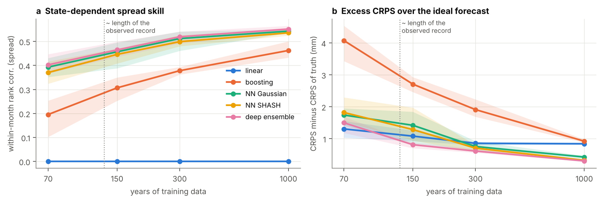
- The networks' state-dependent spread skill rose from 0.37–0.40 with 70 years of training data to about 0.55 with 1000 years.
- They overtook linear regression at about 150 years (deep ensemble) and 300 years (single networks). This is why Part B trains on a 50-member climate-model ensemble (7500 years) instead of on the ~130-year observed record.

## Part B: the same pipeline on real data

The question carried over from Part A: a model trained in a climate model's world reports its own confidence. Is that confidence reliable on unseen members of the same model, and on the real world?

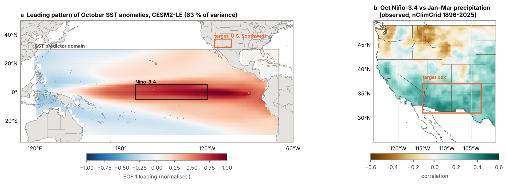
*(a) Leading pattern of October tropical Pacific SST anomalies in CESM2-LE (ENSO, 63 % of variance) with the Niño-3.4 box. (b) Observed correlation of October Niño-3.4 with January–March precipitation (nClimGrid, 1896–2025) and the U.S. Southwest target box.*

| | |
|---|---|
| Training data | CESM2-LE, CMIP6 forcing variant, 50 members, historical + SSP3-7.0 (1900–2050); split by member 70/15/15 % |
| Observations | ERSSTv5 sea surface temperature; NOAA nClimGrid precipitation (1895–2025) |
| Predictors (October) | first 6 EOFs of tropical Pacific SST anomalies (fitted on training members; observations projected onto them), Niño-3.4, its Jul–Oct tendency, Aug–Oct regional precipitation |
| Target | January–March mean precipitation anomaly, U.S. Southwest (31–37°N, 115–103°W) |
| Forced response | model: ensemble mean removed; observations: quadratic trend removed |
| Reference forecast | leave-one-year-out observed climatology |

The processing steps are each unit-tested on small arrays (`tests/test_preprocess.py`): CESM end-of-interval time stamps relabelled by month, unit conversion with month lengths, area weighting, periodic regridding, common masks and EOFs fitted only on training members. Data provenance (URL, access date, SHA-256) is written to `data/raw/MANIFEST.json`, and the licences and citations are in [`data.md`](data.md).

### Sanity checks on the processed data

- The leading SST EOF explains 63 % of the October variance in CESM2-LE and tracks Niño-3.4 at r = 0.98 in the model and 0.96 in observations.
- October Niño-3.4 correlates with January–March Southwest precipitation at r = 0.44 in CESM2-LE and r = 0.34 in observations (1896–2025), so the model's teleconnection is somewhat stronger than observed.
- Known events are reproduced: the 1982–83 and 1997–98 El Niños were followed by wet winters (target +1.2 and +1.1 σ), and the 2015–16 El Niño by the well-documented dry exception (−0.9 σ).

### Part B results

Samples: 1050 held-out CESM2-LE member-years and 130 observed years. Brackets are 95 % block-bootstrap intervals (5-year blocks). Full tables: [`results/tables/`](../results/tables/).

| Model | CRPSS, CESM2-LE test | CRPSS, observations | Spread/error ratio, observations |
|---|---|---|---|
| linear, constant σ | 0.120 [0.094, 0.145] | 0.058 [−0.038, 0.143] | 0.99 [0.86, 1.15] |
| gradient boosting | 0.113 [0.087, 0.137] | 0.085 [0.007, 0.156] | 1.09 [0.96, 1.25] |
| NN, Gaussian | 0.123 [0.097, 0.147] | 0.078 [−0.011, 0.155] | 1.00 [0.87, 1.15] |
| NN, SHASH | 0.121 [0.096, 0.144] | 0.073 [−0.015, 0.146] | 1.01 [0.87, 1.18] |
| deep ensemble | 0.122 [0.096, 0.146] | 0.072 [−0.018, 0.151] | 1.01 [0.88, 1.17] |

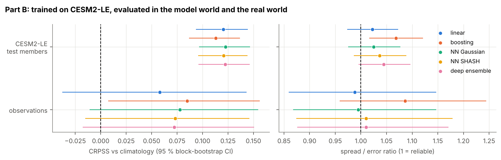

- **Clear skill in the climate-model world.** In held-out CESM2-LE members every model beat climatology by about 12 % in CRPS (Diebold–Mariano, Holm-adjusted p < 10⁻⁴ for all five).
- **Reliable on average in the real world.** Every model's spread/error ratio in observations is compatible with 1, so a model trained only on climate-model data did not become over- or underconfident on average when applied to observations.
- **Physically sensible confidence.** In all three networks the predicted spread rose with October Niño-3.4 (r = 0.68–0.85). Wetter El Niño winters were forecast as more uncertain and drier La Niña winters as less, the same direction as in the initialised SMYLE hindcasts below.

### Perfect-model ground truth for real years (CESM2 SMYLE)

Part B has no exact truth for the predictability of each real year. The closest available reference is an *initialised* hindcast ensemble with the same model: CESM2 SMYLE (Yeager et al., 2022) starts 20 members from the observed state on 1 November of every year 1970–2019. For each real year, the spread of those 20 members for January–March Southwest precipitation is CESM2's own forecast uncertainty from that exact initial state. It plays the role the 1000-member truth plays in Part A, with three caveats: it is the truth *of the model*, not of the real climate; 20 members give a spread estimate with about 16 % sampling error; and it uses the full initial state, so it is an upper bound on what the statistical models could know.

Data: the November-start SMYLE precipitation collection (NCAR GDEX dataset d010074, CC BY 4.0), 51 start years × 20 members, regional January–March means over the same box, drift-corrected, trend-removed and standardised like the observations. Observed target years 1971–2021 (n = 51).

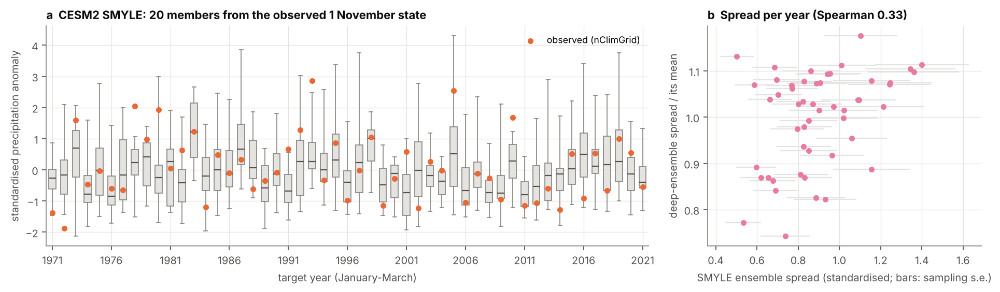

- **A credible reference.**
  - The SMYLE ensemble mean correlates with the observed target at r = 0.45, and with October Niño-3.4 at r = 0.73.
  - Its spread/error ratio against observations is 0.97, so the 20 members are about as wide as the real errors.
  - SMYLE beats climatology (CRPS 0.51 vs 0.61, Diebold–Mariano, Holm-adjusted p = 0.022).
- **Same direction as the networks.** The SMYLE spread is larger in El Niño years (r = 0.37 with Niño-3.4).
- **Statistical models matched the initialised dynamical model** (exploratory, same 51 years). Models trained only on the uninitialised CESM2-LE had the same CRPS as SMYLE: 0.48–0.49 against 0.51, with no significant paired difference (p = 0.42–0.63).

Run with:

```bash
python -m knownpred.experiments.part_b --stage smyle   # reads the needed chunks from thredds.rda.ucar.edu
python -m knownpred.experiments.significance
```

## Open questions and future work

Results that are not yet conclusive, each turned into a next step. All numbers are in [`results/tables/significance.md`](../results/tables/significance.md) and the Part A and Part B tables.

1. **Ranking confidence within a season.** Even the best networks rank the truly predictable cases only moderately within a season (rank correlation ≈ 0.55 at a 3-month lead). *Next:* richer inputs, larger ensembles or architectures, and losses that reward correct ranking directly.
2. **Long-lead advantage.** At a 6-month lead the networks' better spread (rank correlation 0.68–0.75) no longer lowered CRPS relative to linear regression (Holm-adjusted p = 1), because errors of the mean dominate. *Next:* improve the mean forecast at long leads, for example with additional slow predictors.
3. **Spurious attribution.** Every non-linear model attributed some spread to storage (0.06–0.08) and to the two irrelevant inputs (0.03–0.07), all exactly zero in the truth. Storage is correlated with ENSO, and permutation creates unrealistic input combinations. *Next:* test conditional or on-manifold attribution methods against the exact truth, which this testbed provides.
4. **Confidence under a changing climate.** After a stronger teleconnection, the networks were no better calibrated than linear regression. *Next:* train across several climate states (both CESM2-LE forcing variants, past vs future periods), or recalibrate the spread with a small amount of new data.
5. **Statistical power in observations.** With 130 years, no model's gain over climatology in observations survives Holm correction (adjusted p ≥ 0.14), and no model beats linear regression on either dataset. *Next:* more regions and seasons, such as the dry side of the dipole (Pacific Northwest) and the Great Plains, to pool evidence.
6. **Does the networks' confidence order real errors?**

   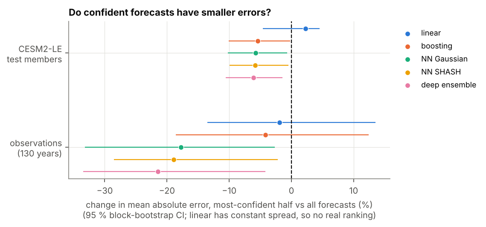
   - In observations, the networks' most-confident half of years had 18–21 % smaller errors (unadjusted p = 0.008–0.033). This passes a 5 % false-discovery-rate control but not Holm's stricter family-wise control. In CESM2-LE the effect was smaller (−6 %).
   - Over 1971–2021 the networks' spread agreed only moderately with SMYLE's (Spearman 0.33–0.35, Holm-adjusted p ≥ 0.12). The SMYLE spread itself did not order the observed errors (p = 0.65).
   - *Question:* does the networks' spread capture a real feature, such as the bounded, skewed dry La Niña winters (observed skewness 1.1 vs 0.7 in CESM2-LE), or is this sampling variability? *Next:* a second initialised model (E3SMv2.1 SMYLE is in the same NCAR collection), longer hindcast sets, and more regions.
7. **More complex models.** Every model enters the evaluation through the same `fit` / `predict` interface and returns a `Forecast` (`src/knownpred/forecast.py`). Larger architectures are therefore scored against the same exact truth and the same statistical tests without changes to the evaluation code: convolutional or U-Net models on full SST fields, or fine-tuned climate foundation models such as Vision Transformers. *Next:* add such a model on gridded predictors and test whether the extra complexity improves the within-season ranking of confidence (item 1).
8. **A richer testbed.** Make storage respond non-linearly (e.g. saturation), so that it truly affects predictability, and check whether attribution then finds it.

## Limitations

- The toy system is deliberately simple: 2 + 1 + 1 variables and linear dynamics apart from the noise. Results show how methods behave when the answer is known, not how they will behave in a high-dimensional climate model. They are also tied to the parameter choices in [`methods.md`](methods.md).
- Truth-based metrics carry Monte Carlo error: about 2–3 % of each true σ with 1000 members.
- Only one network architecture size is tested, and the hyperparameters were not tuned. A conclusion of the form "networks do or do not recover X" holds for this setup only.
- Each network configuration was trained once per experiment (one seed; the deep ensemble aside). Seed-to-seed spread is visible only in the training-length experiment (three repeats).
- In Part B, removing a quadratic trend from a single observed realisation is a crude estimate of the forced response. Standardising each dataset by its own statistics corrects variance bias but uses two statistics (mean, standard deviation) from 1951–2010, which lies inside the evaluation period. The observational evaluation has 130 samples, so its confidence intervals are wide, and the Part B results come from one region, one season and one lead.
- The SMYLE comparison covers 51 years and one model; SMYLE's 20-member spread carries ~16 % sampling error per year, and its truth is CESM2's, not the real climate system's.
- The observational test is not fully independent of model development: the region, season and predictors were chosen before seeing the results, but the well-known ENSO teleconnection to the Southwest is the reason they were chosen.
